# Layout Schematic Visualizer (lsv)

Desktop tool to visualize and analyze a gate-level netlist, its LEF/DEF block layout and its standard cells. One object is shown in every view at once: a cell or net of the netlist, its shapes in the block layout, the transistors of its standard cell, and their shapes in the cell GDS.

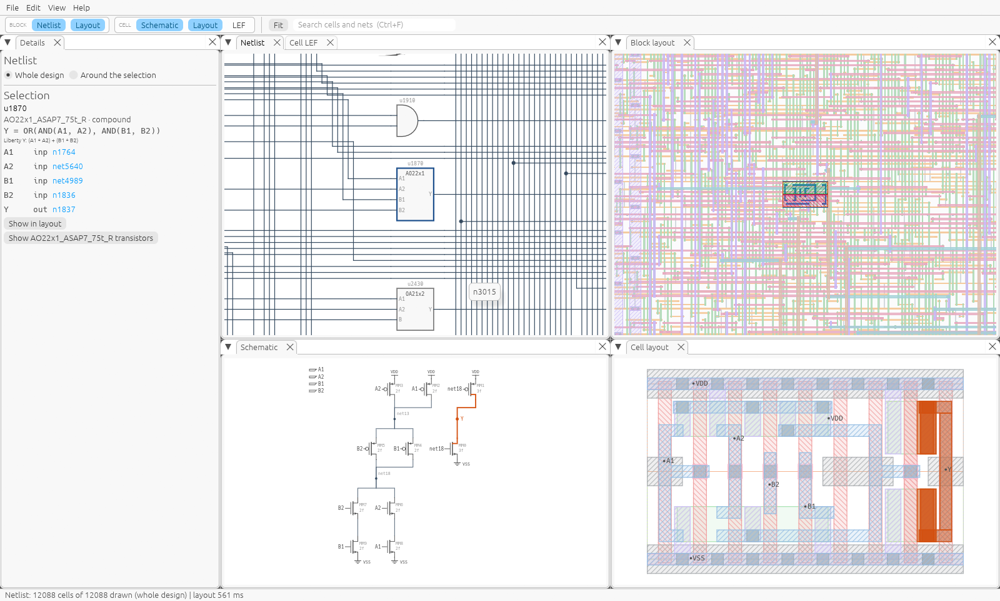

*ASAP7 aes. A click on instance u1870 in the netlist (top left) picks it in the block layout (top right) and opens its cell AO22x1 below, with the output net Y lit in the schematic and in the layout.*

## Why

After every design run, the results and the extracted metrics were hard to check by eye. Opening them on the server over X11 or VNC works, but the lag makes it slow. lsv opens the same files on your own machine, so the netlist, the block layout and the standard cells can be looked at directly, and how a cell relates to the block is one click away. Basic comparison and analysis features will keep being added.

## Features

1. [One instance in four views](#1-one-instance-in-four-views)
2. [Nets across the netlist and the block layout](#2-nets-across-the-netlist-and-the-block-layout)
3. [Netlist with gate symbols](#3-netlist-with-gate-symbols)
4. [Cells around the selection](#4-cells-around-the-selection)
5. [Hierarchy folded into boxes](#5-hierarchy-folded-into-boxes)
6. [Block layout with layers](#6-block-layout-with-layers)
7. [Standard cell schematic and layout (cell LVS)](#7-standard-cell-schematic-and-layout-cell-lvs)
8. [Why a cell fails LVS](#8-why-a-cell-fails-lvs)
9. [Cell LEF](#9-cell-lef)
10. [Logic check](#10-logic-check)
11. [Open PDKs](#11-open-pdks)
12. [Post-layout parasitics](#12-post-layout-parasitics)
13. [Command-line checks](#13-command-line-checks)
14. [Views, files, themes and languages](#14-views-files-themes-and-languages)

### 1. One instance in four views

A click on an instance in the netlist or the block layout picks it in the other view and opens its standard cell in the cell schematic and cell layout (picture at the top, `--tab all`). A transistor or net picked in the cell schematic lights its gate, diffusion and metal in the cell layout, and the other way round.

### 2. Nets across the netlist and the block layout

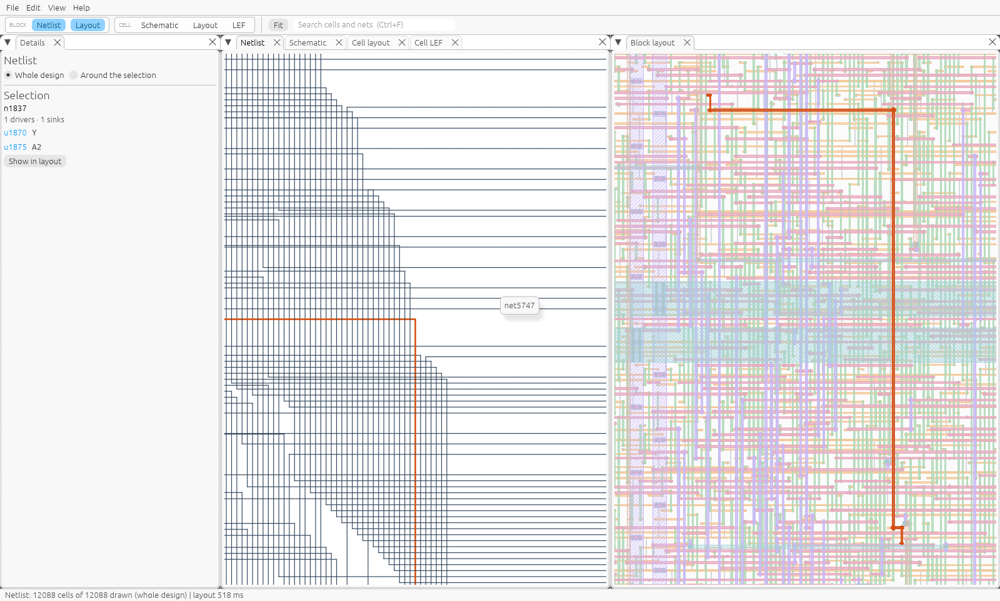

A picked net lights its whole route in the block layout and its wire in the netlist, and the Details panel lists its driver and sinks. ASAP7 aes, net n1837 from u1870/Y to u1875/A2 (`--tab block-both`).

### 3. Netlist with gate symbols

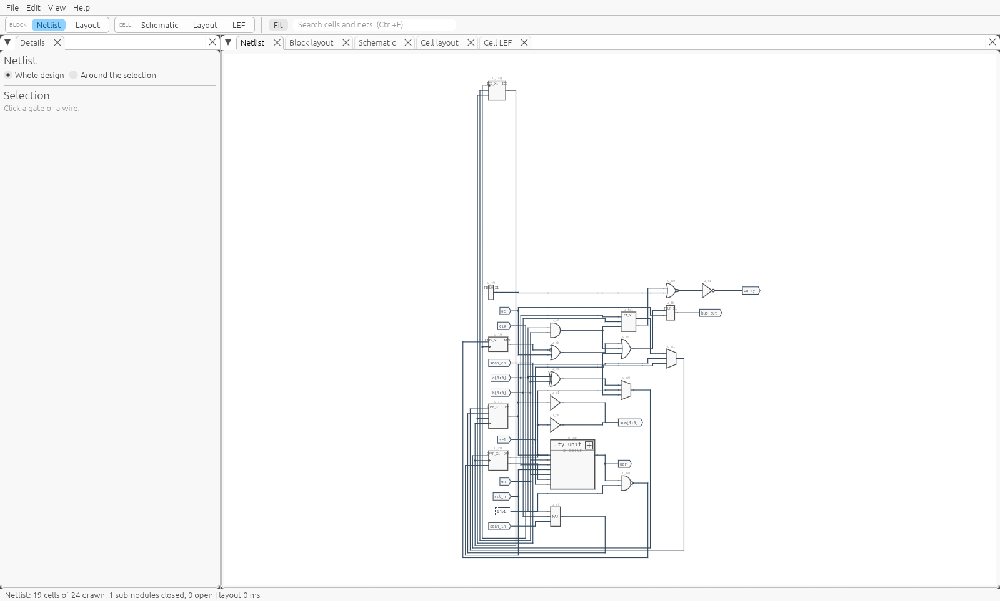

Cells with a Liberty function get gate symbols with bubbles on inverted inputs, other cells are boxes with pins (`examples/demo/demo_top.v`). Ctrl+F jumps to a cell or net.

### 4. Cells around the selection

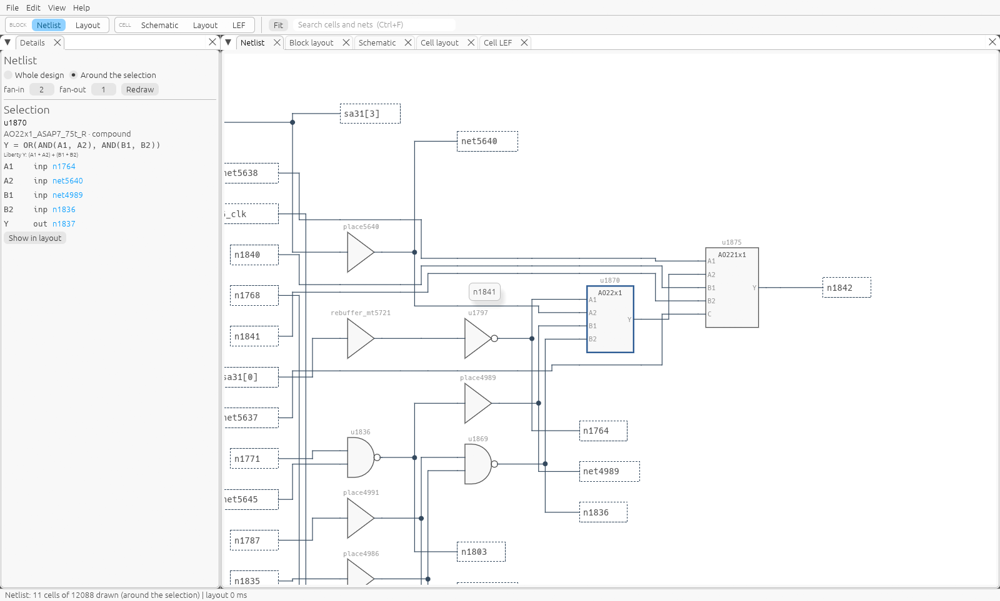

Around the selection draws only the cells within the chosen fan-in and fan-out of the selection: here 11 of the 12,088 cells of aes around u1870. Designs too large for one sheet open this way.

### 5. Hierarchy folded into boxes

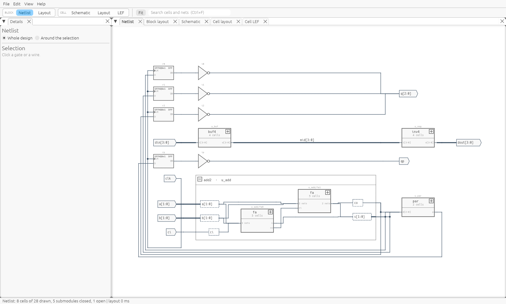

Submodules start folded: + opens a box in place, - closes it. Flat netlists are folded by their instance-name paths. Nets between the same pins are drawn as one bundle labelled with the bus range (`examples/demo/hier_adder.v` with u_add opened).

### 6. Block layout with layers

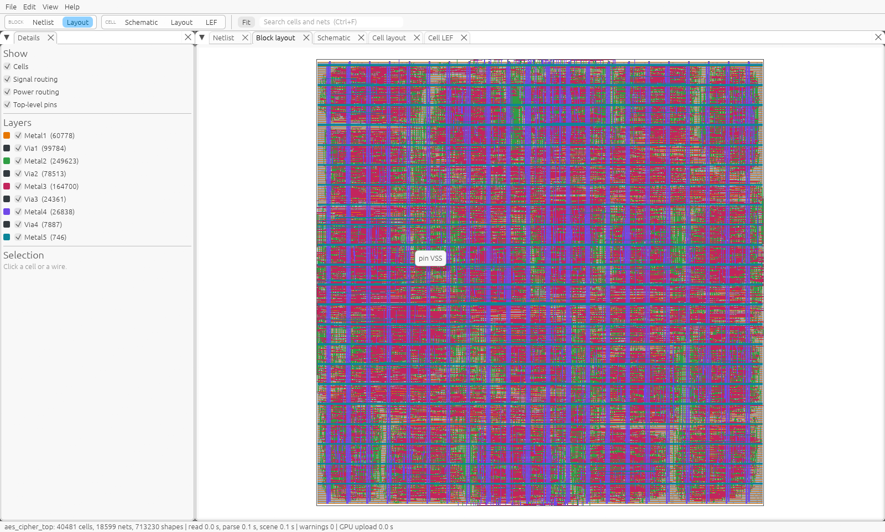

LEF/DEF drawn on the GPU, with cells, signal routing, power routing, top-level pins and every layer switched on and off. GF180MCU aes, 40,481 cells. Large DEF files are streamed: a routed 4.7 GB DEF (2.7 million components) opens with about 14 GB of memory.

### 7. Standard cell schematic and layout (cell LVS)

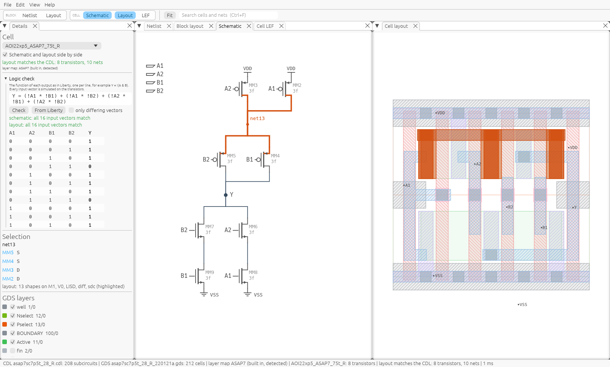

The CDL cell as a transistor schematic and the GDS cell as layout. The layout is extracted with a built-in preset picked from the GDS layers and matched to the CDL like an LVS (AOI22xp5 with net13 picked).

### 8. Why a cell fails LVS

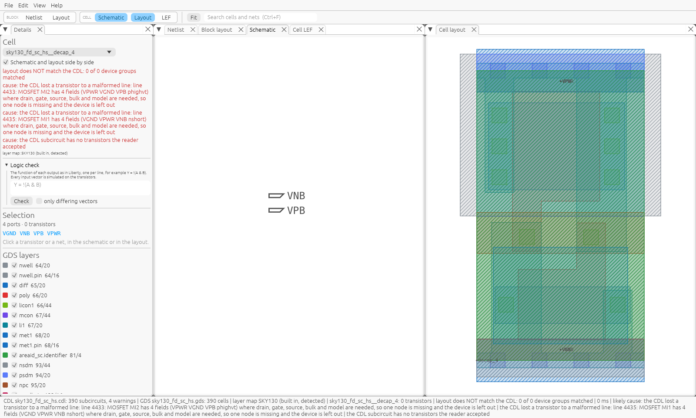

When a layout does not match its CDL, the likely cause is stated. Here the public SKY130 hs CDL loses both transistors of decap_4, because each of their lines misses a node.

### 9. Cell LEF

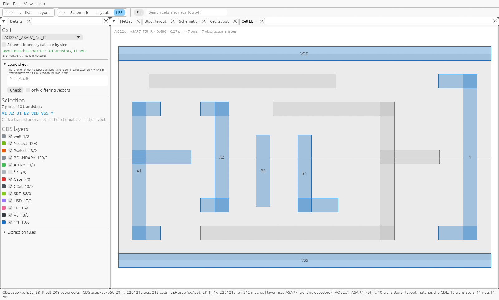

The cell LEF with its pins and obstructions (`--cell-lef`), AO22x1.

### 10. Logic check

| Liberty functions, all vectors match | A wrong function for SN, every vector differs |
|---|---|
| 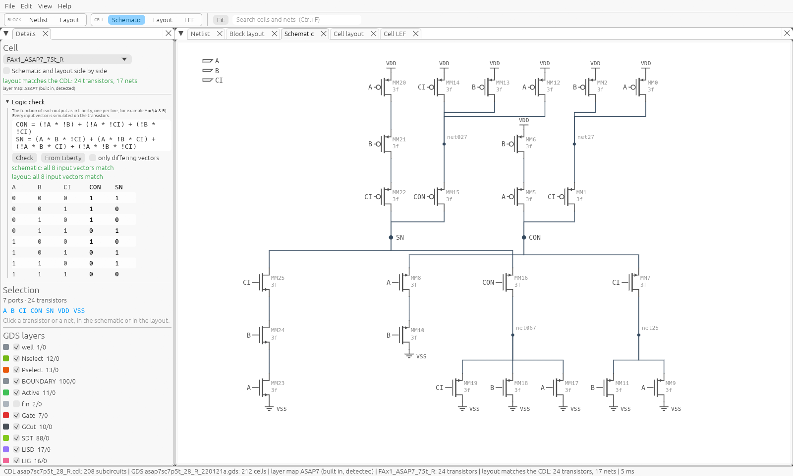 | 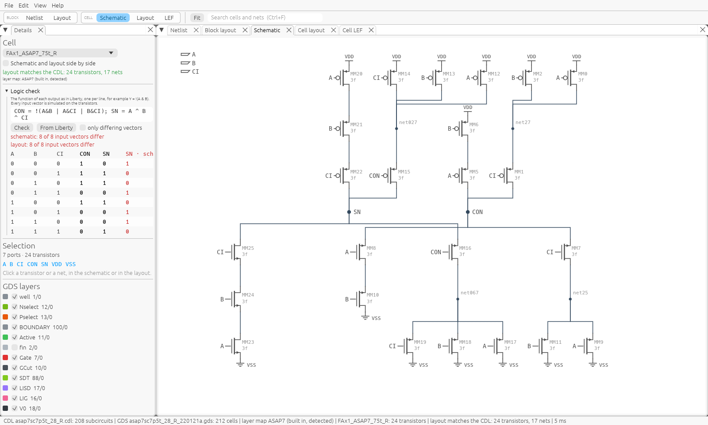 |

Details > Logic check takes the output functions as in Liberty (`Y = !(A & B)`, `three_state(Z) = !EN`) and simulates every input vector on the cell schematic and on the transistors extracted from the layout. A truth table shows the differing levels in red.

Each transistor is a switch. Nodes the switches leave open are tried at every steady state, and a fight is settled by the transistor sizes. An output is 0 or 1 only when every steady state agrees and the level is full swing, so a short, a second stable state, a floating output or a degraded level fails. Limits: combinational outputs only, up to 16 inputs, 16 open nodes and about four million state evaluations per check, sizes as linear W/L conductances.

### 11. Open PDKs

Extraction presets for ASAP7, Nangate45, SKY130, IHP SG13G2, GF180MCU and GT3 are picked from the layers of the GDS. A preset file (`--pdk FILE.lsvpdk`, or found through `LSV_PDK_PATH`) adds another PDK without rebuilding. Pictures of the four other PDKs are in [Try it on an open PDK](#try-it-on-an-open-pdk).

### 12. Post-layout parasitics

Parasitics are shown by metal segment, the way the extractor splits them, not by net. A picked R lights the metal between its two nodes and draws a resistor in it. A C to ground draws a capacitor to a ground symbol. A coupling C draws a capacitor between its two segments.

- Block: a SPEF with node coordinates (`--spef`), on the block layout. Pick a net, then an R or C in Details.
- Cell: a post-layout netlist opened instead of the CDL (`--lpe`): Magic ext2spice with its `.res.ext`, DSPF, a netlist split into .pex and .pxi files, or a flat netlist with R and C.

Both examples come from open-source extractors: `examples/aes/aes_cipher_top_6_final.spef.gz` from OpenRCX (OpenROAD), and `examples/sky130hd/magic_pex/` from Magic.

| Block: R of `clk` on M7 (OpenRCX) | Block: coupling C of `clk` on M6 (OpenRCX) |
|---|---|
| 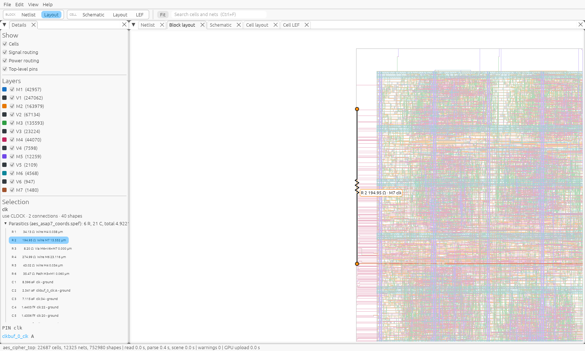 | 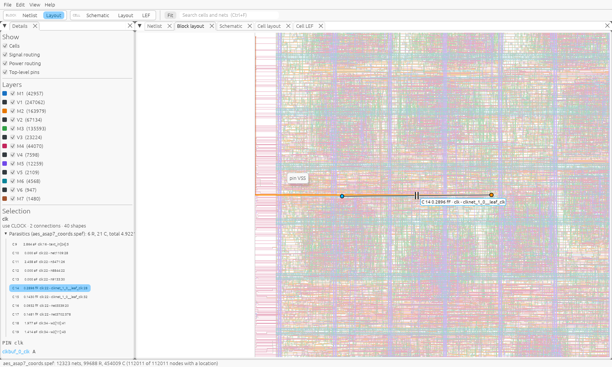 |
| **Cell: R of B1 on poly, a21oi_1 (Magic)** | **Cell: coupling C between B1 and Y, a21oi_1 (Magic)** |
| 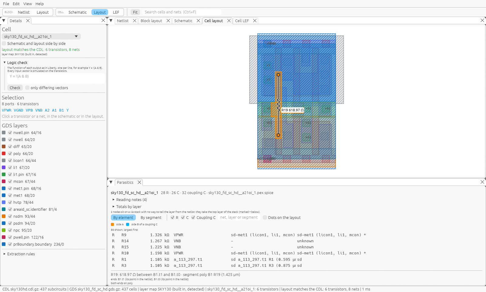 | 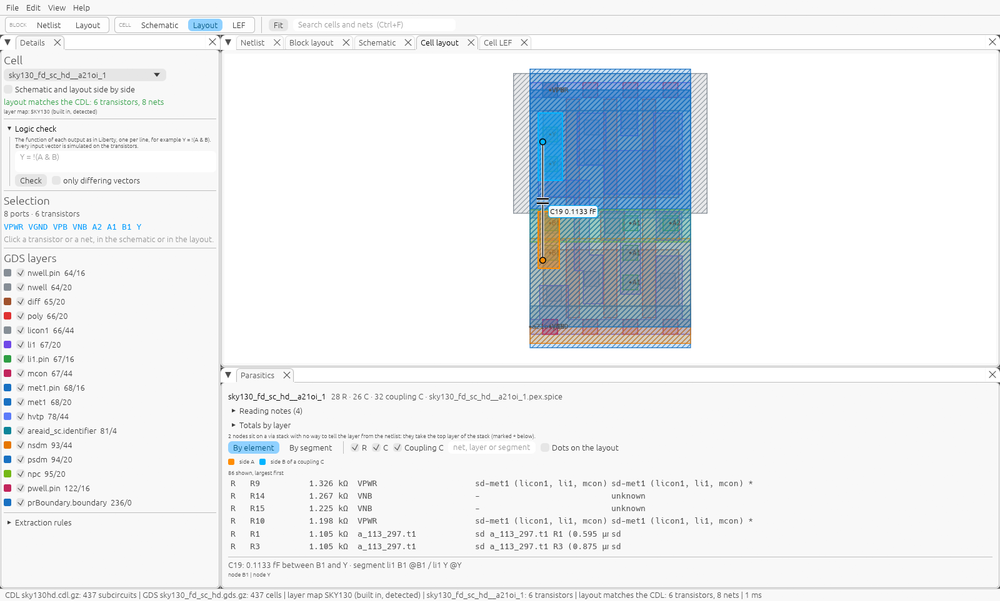 |

### 13. Command-line checks

The same checks run on whole libraries without a window (SKY130 hd example):

```
$ lsv-lvs examples/sky130hd/sky130_fd_sc_hd.gds.gz examples/sky130hd/sky130hd.cdl.gz
OK     sky130_fd_sc_hd__xor2_4  devices 10 cdl / 40 layout fingers, groups 4, nets 11, warnings 0
cells 437: OK 437, FAIL 0 (of which 0 match when fins are ignored), no CDL 0, 3.5 s

$ lsv-func examples/sky130hd/sky130hd.cdl.gz --lib examples/sky130hd/sky130_fd_sc_hd__tt_025C_1v80.lib.gz --gds examples/sky130hd/sky130_fd_sc_hd.gds.gz
OK    sky130_fd_sc_hd__a2bb2o_1  4 inputs | schematic 16/16 | layout 16/16
summary: 346 checked, 346 OK, 0 FAIL | 69 sequential, 11 without a function, 0 not in the Liberty files | 4527 vectors | 1.1 s

$ lsv-check --def examples/sky130hd/aes_cipher_top_6_final.def.gz --lef examples/sky130hd/sky130_fd_sc_hd.tlef --lef examples/sky130hd/sky130_fd_sc_hd_merged.lef.gz
DEF aes_cipher_top: 38858 comps, 15255 nets, 390 pins, 576345 rects, 13 layers, warnings 0

$ lsv-spef examples/aes/aes_cipher_top_6_final.spef.gz --def examples/aes/aes_cipher_top_6_final.def.gz --lef examples/aes/asap7_tech_1x_201209.lef --lef examples/aes/asap7sc7p5t_28_R_1x_220121a.lef
SEGMENTS: nets in the DEF 12323/12323 | 44056 wire, 50289 path, 5343 via, 16683 patch | R without a segment 0 | C on a segment 454009, without 0 | ...
```

`lsv-func --negate` checks the inverted functions as a control, so every cell must fail.

### 14. Views, files, themes and languages

- Every view is a tab: drag it next to another view, or right click it to open it in its own window. View > Reset layout brings back the start layout.
- Files come from the command line, the File menu or a drop on the window. Gzipped files are read as they are.
- View > Theme: light or dark. View > Language: English, Korean, Japanese, Chinese, Spanish, German and French.

## Build

Rust 1.95 or newer. `cargo build --release` builds `target/release/lsv` and the command-line checks `lsv-lvs`, `lsv-func`, `lsv-check`, `lsv-spef` and `lsv-lpe`.

| Platform | Build | Package |
|---|---|---|
| Windows (x86_64) | `cargo zigbuild --release --target x86_64-pc-windows-gnu` | |
| Linux (x86_64, glibc 2.28+) | `cargo zigbuild --release --target x86_64-unknown-linux-gnu.2.28` | `scripts/package_linux.sh dist` |
| macOS (Apple Silicon) | `cargo build --release` | `scripts/package_macos.sh dist` |

## Try it on an open PDK

Each example folder holds the routed aes block of the public OpenROAD-flow-scripts CI with the LEF, Liberty, CDL and GDS of one open PDK (sources in its `SOURCES.md`).

ASAP7:

```
lsv --tab all --lib examples/aes/asap7sc7p5t_RVT_TT_lite.lib --netlist examples/aes/aes_cipher_top_6_final.v.gz \
    --lef examples/aes/asap7_tech_1x_201209.lef --lef examples/aes/asap7sc7p5t_28_R_1x_220121a.lef \
    --def examples/aes/aes_cipher_top_6_final.def.gz \
    --cdl examples/cells/asap7sc7p5t_28_R.cdl --gds examples/cells/asap7sc7p5t_28_R_220121a.gds
```

Other PDKs (set `E` to the folder):

```
lsv --tab all --lib $E/<Liberty> --netlist $E/aes_cipher_top_6_final.v.gz --lef $E/<tech LEF> --lef $E/<cell LEF> \
    --def $E/aes_cipher_top_6_final.def.gz --cdl $E/<CDL> --gds $E/<GDS>
```

| `E` | Liberty | tech LEF | cell LEF | CDL | GDS |
|---|---|---|---|---|---|
| `examples/nangate45` | `NangateOpenCellLibrary_typical.lib.gz` | `NangateOpenCellLibrary.tech.lef` | `NangateOpenCellLibrary.macro.mod.lef` | `NangateOpenCellLibrary.cdl` | `NangateOpenCellLibrary.gds` |
| `examples/sky130hd` | `sky130_fd_sc_hd__tt_025C_1v80.lib.gz` | `sky130_fd_sc_hd.tlef` | `sky130_fd_sc_hd_merged.lef.gz` | `sky130hd.cdl.gz` | `sky130_fd_sc_hd.gds.gz` |
| `examples/ihp-sg13g2` | `sg13g2_stdcell_typ_1p20V_25C.lib.gz` | `sg13g2_tech.lef` | `sg13g2_stdcell.lef` | `sg13g2_stdcell.cdl` | `sg13g2_stdcell.gds.gz` |
| `examples/gf180mcu` | `gf180mcu_fd_sc_mcu9t5v0__tt_025C_5v00.lib.gz` | `gf180mcu_5LM_1TM_9K_9t_tech.lef` | `gf180mcu_5LM_1TM_9K_9t_sc.lef.gz` | `gf180mcu_fd_sc_mcu9t5v0.cdl.gz` | `gf180mcu_fd_sc_mcu9t5v0.gds.gz` |

| Nangate45: `_11863_` (AOI22_X1), output ZN | SKY130: `_11040_` (a21oi_1), output Y |
|---|---|
| 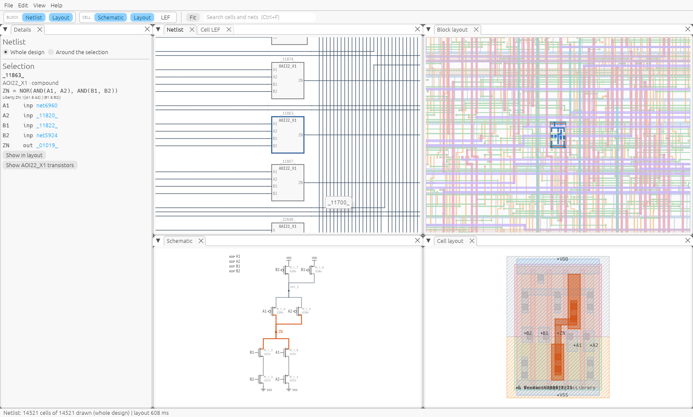 | 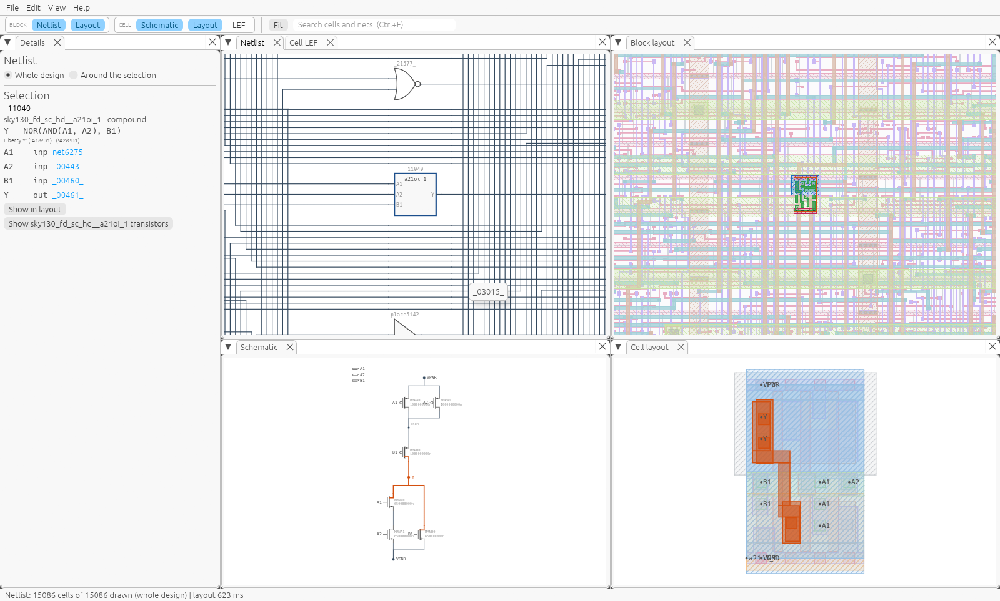 |
| **IHP SG13G2: `u10005` (sg13g2_a21oi_1), output Y** | **GF180MCU: `_14917_` (aoi21_2), output ZN** |
| 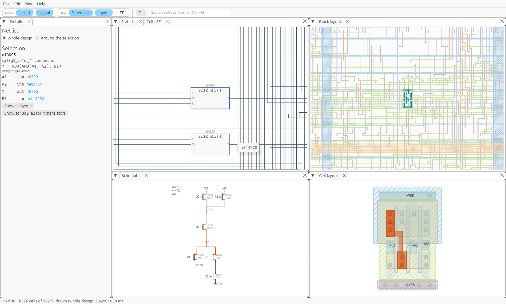 | 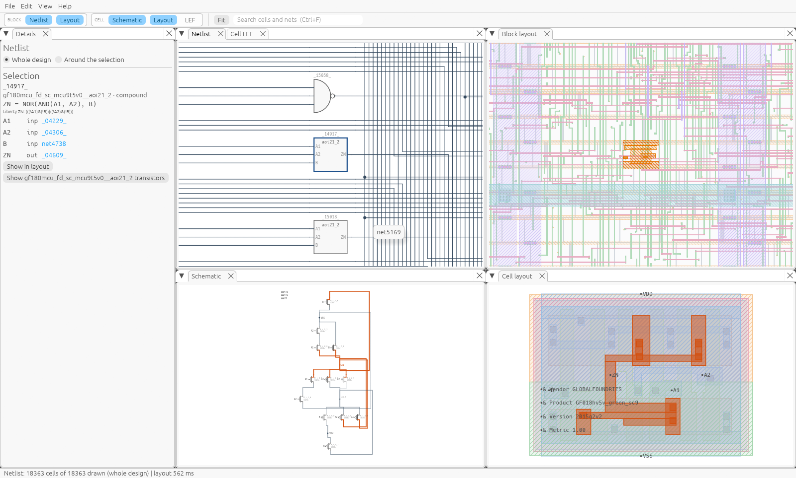 |

Command-line checks on the same files:

```
lsv-lvs   $E/<GDS> $E/<CDL>                              # every cell layout against its CDL
lsv-func  $E/<CDL> --lib $E/<Liberty> --gds $E/<GDS>     # every cell against its Liberty function
lsv-check --def $E/aes_cipher_top_6_final.def.gz --lef $E/<tech LEF> --lef $E/<cell LEF>
```

| Library | Layout matches CDL | Logic matches Liberty | Not logic-checked | aes block |
|---|---|---|---|---|
| ASAP7 (asap7sc7p5t_28 R) | 208 of 208 (4 GDS cells have no CDL) | 169 of 169 | 33 sequential, 6 decap | 22,687 components, 0 warnings |
| Nangate45 | 135 of 135 | 98 of 98 | 29 sequential, 8 fill, tap, antenna | 32,182 components, 0 warnings |
| SKY130 hd | 437 of 437 | 346 of 346 | 69 sequential, 22 decap, fill, tap, diode, tie, bleeder | 38,858 components, 0 warnings |
| SKY130 hs | 388 of 390 (decap_4 and decap_8 have malformed CDL lines) | 305 of 305 | 68 sequential, 17 decap, fill, tap, diode, tie | |
| IHP SG13G2 | 84 of 84 | 60 of 60 | 17 sequential and bus holder, 7 decap, fill, antenna | 27,155 components, 0 warnings |
| GF180MCU 9t and 7t | 229 of 229 each | 159 of 159 each | 55 sequential and bus holder, 15 fill, decap, tap, antenna | 40,481 components, 0 warnings (9t) |
| GT3 rvt | 65 of 65 | (no Liberty file) | | |

No checked cell fails. Sequential cells (flip-flops, latches, clock gates) and bus holders store a state and are not logic-checked, and decap, fill, tap, antenna and tie cells have no logic function or no transistors.

## Command line

```
lsv [--tab netlist|layout|cell|cell-layout|cell-lef|cell-both|block-both|all|parasitics]
    [--lib <cells.lib>]... [--netlist <design.v>] [--top <module>]
    [--lef <file.lef>]... [--def <design.def>] [--spef <design.spef>]
    [--cdl <cells.cdl>] [--lpe <cell.pex.sp>] [--gds <cells.gds>] [--cell-lef <cells.lef>]
    [--layermap <map>] [--cell <name>]
lsv-lvs  <cells.gds> <cells.cdl> [layermap] [--pdk NAME|auto|FILE.lsvpdk] [--rules FILE] [--only NAME]
lsv-func <cells.cdl|post-layout.sp> --lib <cells.lib>... [--gds <cells.gds>] [--only NAME] [--func "Y = !(A & B)"] [--negate] [--rows] [--trace]
lsv-check --def <design.def> --lef <tech.lef> [--lef <cells.lef>]...
lsv-spef <design.spef> --def <design.def> --lef <file.lef>... [--net NAME]...
lsv-lpe  <cell.pex.sp>... --gds <cells.gds> [--cdl <cells.cdl>] [--pdk NAME] [--segments]
```

## License

BSD 3-Clause, see `LICENSE`. Example files keep their own licenses (`examples/ASAP7_LICENSE`, `examples/aes/LICENSE`, and `LICENSE` with `SOURCES.md` in each PDK folder). Built-in libraries and fonts are listed in `THIRD_PARTY_LICENSES.txt`.

## References

- OpenROAD-flow-scripts (aes design, CI, platform files): https://github.com/The-OpenROAD-Project/OpenROAD-flow-scripts
- ASAP7 standard cells: https://github.com/The-OpenROAD-Project/asap7sc7p5t_28
- SKY130: https://github.com/google/skywater-pdk
- IHP SG13G2: https://github.com/IHP-GmbH/IHP-Open-PDK
- GF180MCU standard cells: https://github.com/google/globalfoundries-pdk-libs-gf180mcu_fd_sc_mcu9t5v0
